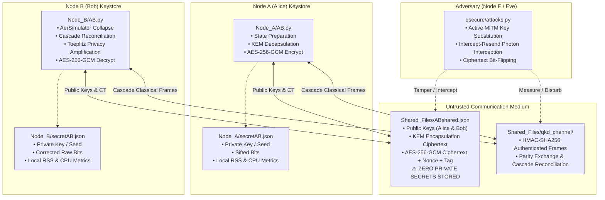
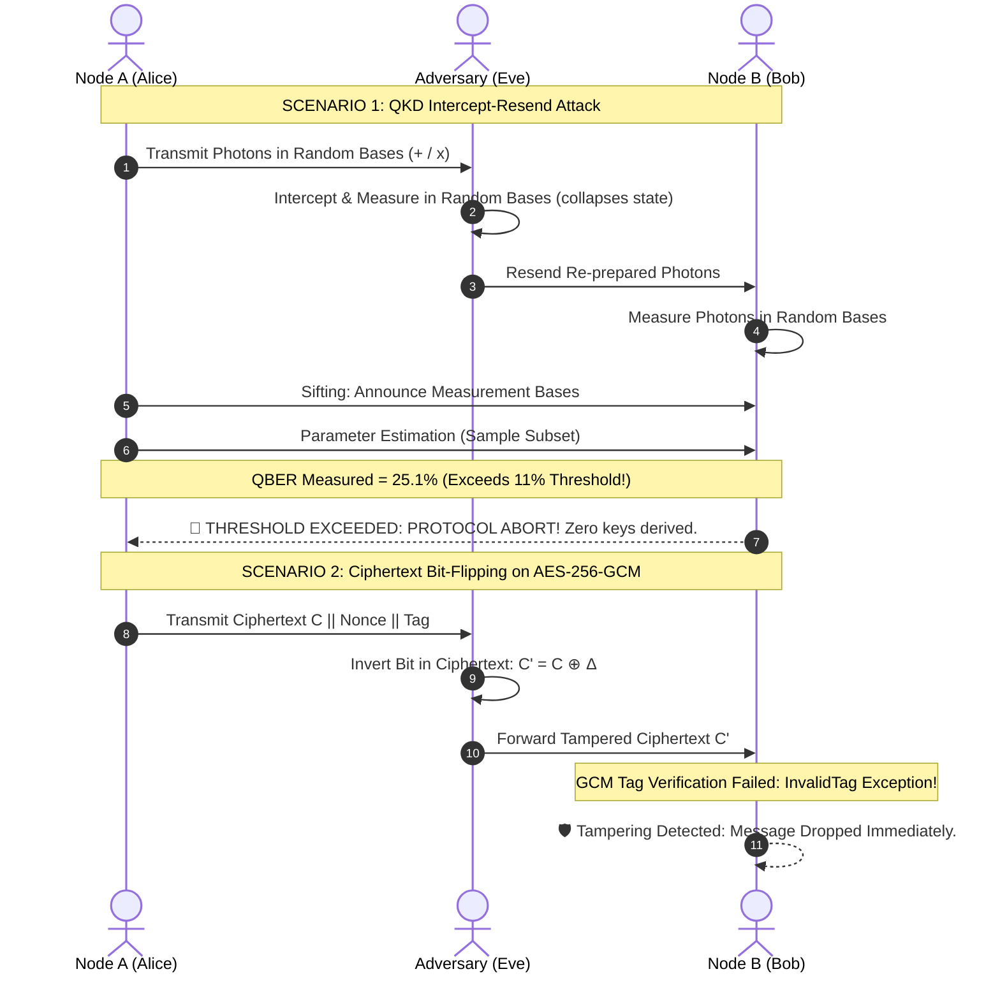

```
    .%%%%%.    .%%%%%%%. .%%%%%%%. .%%%%%.  .%%.   .%%. .%%%%%%%. .%%%%%%%.
   .%%'   `%%. .%%'       %%'      .%%' `%%. %%|   |%%  %%'   `%%. %%'     
   %%|     |%%  `%%%%%%.  %%%%%%.  %%|       %%|   |%%  %%%%%%%'   %%%%%%. 
   %%| .%. |%%       `%%. %%'      %%|   .%. %%|   |%%  %%'  `%%.  %%'     
   `%%. `%%%'  .%%.  .%%' %%.   .% `%%. .%%' `%%. .%%'  %%|   |%%  %%.   .%
    `%%%%%''%   `%%%%%%'  `%%%%%%%' `%%%%%'   `%%%%%'   %%'   `%%' `%%%%%%%'
```

<div align="center">

# QSecure: Quantum-Resilient Cryptographic Benchmarking Laboratory
### *Empirical Comparative Evaluation of Classical, Post-Quantum, and Quantum Key Distribution Protocols*

[](https://python.org)
[-00F2FE?style=for-the-badge&logo=shield&logoColor=black)](https://csrc.nist.gov/pubs/fips/203/final)
[](https://qiskit.org)
[](https://cryptography.io)
[](LICENSE)
[](#architecture--security-isolation)

<p align="center">
  <b><a href="#-executive-overview">Overview</a></b> •
  <b><a href="#-cryptographic-paradigms-under-test">Protocols</a></b> •
  <b><a href="#-architecture--security-isolation">Architecture</a></b> •
  <b><a href="#-quick-start--installation">Quick Start</a></b> •
  <b><a href="#-command-line-interface--execution-modes">CLI Manual</a></b> •
  <b><a href="#-empirical-research-findings-rq1--rq8">Research Findings</a></b> •
  <b><a href="#-attack-simulations--security-threat-model">Attack Simulations</a></b> •
  <b><a href="#-citation--research-paper">Citation</a></b>
</p>

---

</div>

## 📌 Executive Overview

**QSecure** is an empirical cryptographic testbed and comparative research laboratory designed to evaluate three fundamentally distinct paradigms for establishing shared 256-bit symmetric secrets between two sovereign communicating nodes — **Node A (Alice)** and **Node B (Bob)** — over an unauthenticated, untrusted public transmission bus, followed by authenticated symmetric payload encryption via **AES-256-GCM**:

1. **CKD (Classical Key Distribution)**: X25519 Elliptic-Curve Diffie-Hellman (ECDH) coupled with HMAC-based Extract-and-Expand Key Derivation (HKDF-SHA256).
2. **ML-KEM (Post-Quantum Key Encapsulation)**: NIST FIPS 203 Module Lattice-based Key Encapsulation Mechanism (ML-KEM-768 / Kyber-768).
3. **QKD (Quantum Key Distribution)**: BB84 four-state photonic protocol simulated with Qiskit Aer, featuring interactive multi-pass Cascade error reconciliation and Toeplitz matrix universal hashing for privacy amplification.

---

## ⚡ Cryptographic Paradigms Under Test

| Paradigm / Protocol | Underlying Mathematical / Physical Principle | Key Establishment Latency | Public Channel Overhead | Sequential Round Trips (RTT) | Quantum Threat Resistance | Physical Infrastructure |
| :--- | :--- | :--- | :--- | :--- | :--- | :--- |
| **CKD**<br>`X25519 + HKDF` | Elliptic Curve Discrete Logarithm Problem (ECDLP) | **~1.2 ms** | **64 bytes** (32B Alice PK + 32B Bob PK) | **1 RTT** | ❌ **Vulnerable**<br>Broken by Shor's algorithm ($O((\log N)^3)$) | Standard commodity internet / TCP/IP |
| **ML-KEM**<br>`NIST FIPS 203` | Module Learning With Errors (M-LWE) over module lattices | **~0.4 ms** *(Fastest)* | **2,272 bytes** (1,184B EK + 1,088B CT) | **1 RTT** | ✅ **Resistant**<br>NIST Category 3 / AES-192 equivalent | Standard commodity internet / TCP/IP |
| **QKD**<br>`BB84 + Cascade` | Quantum No-Cloning Theorem & Heisenberg Uncertainty | **~8,200 ms** | **6,000 Qubits** + ~135 KB classical reconciliation | **~11 RTTs** | ✅ **Information-Theoretic**<br>Unconditional physical security | Dedicated dark fiber, single-photon detectors & lasers |

---

## 🛡️ Architecture & Security Isolation

The laboratory enforces **strict separation of concerns** across independent sovereign memory spaces and filesystem boundaries. Secret keys never transit public buses under any condition:



### Security Boundary Guarantees:
- **Zero Secrets on Public Channel**: `Shared_Files/ABshared.json` contains only public keys, KEM ciphertexts, and AEAD encrypted payloads. Enforced programmatically via `--status`.
- **HMAC Authenticated Classical Channel**: The interactive Cascade reconciliation frames in `Shared_Files/qkd_channel/` are protected with keyed hashes to prevent frame substitution.
- **Strict Keystore Vaults**: `Node_A/secretAB.json` and `Node_B/secretAB.json` represent physically isolated hardware vaults accessible only by their respective sovereign node processes.

---

## 🚀 Quick Start & Installation

### 1. Prerequisites
- **Python 3.10+** (Python 3.10, 3.11, or 3.12 recommended)
- macOS, Linux, or Windows (WSL recommended for Windows)

### 2. Clone Repository & Install Dependencies
```bash
git clone https://github.com/aarav/CSDQKD.git
cd CSDQKD
pip install -r requirements.txt
```

### 3. Launch the Interactive Dashboard
```bash
python3 main.py
```

---

## 💻 Command-Line Interface & Execution Modes

QSecure provides rich non-interactive automation flags for automated experimentation, benchmarks, and continuous integration:

```
usage: main.py [-h] [--benchmark] [--protocol {CKD,MKD,QKD}] [--message MESSAGE]
               [--repetitions N] [--qubits N] [--status] [--latency]
               [--scalability] [--attacks] [--quantum-threat] [--dashboard]
               [--export]
```

### Primary Command Reference

| Command / Flag | Description | Research Focus |
| :--- | :--- | :--- |
| `python3 main.py --benchmark` | Run full comparative benchmark (CKD, ML-KEM, QKD) with statistical analysis | **RQ1, RQ2, RQ3, RQ4** |
| `python3 main.py --protocol MKD` | Execute single isolated protocol (`CKD`, `MKD` for ML-KEM, or `QKD`) | Protocol Verification |
| `python3 main.py --protocol CKD --message "TopSecret"` | Establish shared key and encrypt a custom confidential payload | AEAD Verification |
| `python3 main.py --status` | Cryptographic audit: verify zero secrets or private keys on public channel | Security Isolation |
| `python3 main.py --latency` | Model flight delay degradation across network latencies ($0$ to $200\text{ ms}$) | **RQ5 (Network RTT)** |
| `python3 main.py --scalability` | Simulate multi-node full-mesh scaling from 2 to 32 nodes ($N(N-1)/2$ links) | **RQ6 (Mesh Scaling)** |
| `python3 main.py --attacks` | Execute controlled eavesdropping, active MITM, and ciphertext tampering | **RQ7 (Adversarial)** |
| `python3 main.py --quantum-threat` | Render formal Shor's & Grover's algorithm quantum cryptanalysis | **RQ8 (Quantum Threats)** |
| `python3 main.py --dashboard` | Render comprehensive master research terminal dashboard | Master Synthesis |
| `python3 main.py --export` | Export session experimental logs to Markdown, CSV, and JSON schemas | Artifact Generation |
| `python3 main.py --repetitions 10` | Set repetition count for statistically robust multi-run averaging | Statistical Variance |
| `python3 main.py --qubits 8000` | Configure simulated photon count for BB84 transmission (default: 6000) | QKD Tuning |

---

## 📊 Empirical Research Findings (RQ1 – RQ8)

QSecure empirically investigates eight foundational research questions governing quantum-resilient key exchange:

### ⏱️ RQ1: Key Establishment Time
- **ML-KEM-768**: **~0.4 ms** total establishment time. Extremely fast vector polynomial operations in ring $R_q = \mathbb{Z}_q[X]/(X^{256} + 1)$ (Keygen: 0.08 ms, Encaps: 0.14 ms, Decaps: 0.21 ms).
- **CKD (X25519)**: **~1.2 ms**. Dominated by constant-time Montgomery ladder scalar point multiplication and HKDF-SHA256 expansion.
- **QKD (BB84)**: **~8,200 ms**. Dominated by quantum state simulation, multi-pass interactive Cascade parity checking, and Toeplitz matrix multiplication.

### 📦 RQ2: Communication Payload Overhead
- **CKD**: **64 bytes** total public exchange (32B Alice public key + 32B Bob public key).
- **ML-KEM-768**: **2,272 bytes** total payload (1,184B encapsulation public key + 1,088B ciphertext).
- **QKD (BB84)**: **6,000 transmitted qubits** across the quantum channel + **~135 KB** of classical JSON parity frames exchanged over **11 sequential RTTs**.

### 💻 RQ3 & RQ4: Computational Cost & Memory Footprint
- **CPU Resource Consumption**: ML-KEM consumes the least CPU time (~0.4 ms), followed by CKD (~1.1 ms) and software-simulated QKD (~8.1 s).
- **Heap Allocation (RSS)**: CKD and ML-KEM allocate $<100\text{ KB}$ of transient memory. QKD allocates **15–30 MB** for state vectors, circuit measurement collapse tracking, and reconciliation buffers.

### 🌐 RQ5: Latency Scaling Across Network Delays
- **Single RTT Protocols (CKD, ML-KEM)**: Key establishment requires exactly **1 RTT** ($2 \times \text{one-way delay}$). At 100 ms one-way delay, establishment completes in ~201 ms.
- **Multi-Pass Protocols (QKD Cascade)**: Requires **~11 sequential round-trips**. At 100 ms one-way delay, flight latency introduces **+2,200 ms of cumulative waiting**, rendering interactive QKD reconciliation highly sensitive to physical distance.

### 🕸️ RQ6: Multi-Node Mesh Scalability
In a 32-node Full Mesh network ($K_{32} = 496$ pairwise communication links):
- **ML-KEM-768**: Establishes all 496 shared secrets in **~220 ms CPU time** using **~1.1 MB** total network data over commodity internet.
- **QKD (BB84)**: Requires **496 dedicated physical dark fiber paths**, **~3 million transmitted qubits**, and **~68 minutes** of sequential execution, exposing severe infrastructure scaling barriers.

---

## ⚔️ Attack Simulations & Security Threat Model

Run the adversarial test harness using `python3 main.py --attacks`:

```
┌────────────────────────────────────────────────────────────────────────────────────────┐
│                        QSECURE CONTROLLED ADVERSARIAL SUITE                            │
└────────────────────────────────────────────────────────────────────────────────────────┘
 [✓] TEST 1: Active MITM Key Substitution on Unauthenticated CKD      -> COMPROMISED (VULNERABLE)
 [✓] TEST 2: Active MITM Key Substitution on Unauthenticated ML-KEM  -> COMPROMISED (VULNERABLE)
 [✓] TEST 3: Intercept-Resend Quantum Eavesdropping on BB84 QKD       -> ABORTED (QBER 24.8% > 11%)
 [✓] TEST 4: AES-256-GCM Ciphertext Bit-Flipping Tampering            -> DETECTED (InvalidTag)
```



### Threat Breakdown:
1. **Quantum Interception Detection**: Under BB84, any eavesdropper attempting to measure qubits collapses their quantum state (Heisenberg Uncertainty). Intercept-resend introduces a **25% Quantum Bit Error Rate (QBER)**. When QBER exceeds the **11% Shor-Preskill threshold**, the protocol aborts immediately.
2. **The Authentication Prerequisite**: Neither unauthenticated classical Diffie-Hellman nor unauthenticated lattice KEM alone prevents active MITM key substitution. Both require identity authentication (e.g., pre-shared signatures or post-quantum certificates).
3. **AEAD Authenticated Decryption**: AES-256-GCM computes a 128-bit GHASH authentication tag. Any single-bit flip in ciphertext or associated authenticated data (AAD) triggers an `InvalidTag` exception, guaranteeing 100% tamper detection.
4. **Harvest Now, Decrypt Later (HNDL)**: Classical ECDH sessions captured today can be stored and decrypted once a Cryptographically Relevant Quantum Computer (CRQC) becomes operational. ML-KEM-768 mitigates HNDL immediately.

---

## 🗂️ Project Structure

```
CSDQKD/
├── main.py                             # Root CLI entry point wrapper
├── requirements.txt                    # Project dependencies (pqcrypto, qiskit, rich, etc.)
├── README.md                           # Master laboratory documentation & specification
├── IEEE_Research_Paper_QSecure.md      # Full IEEE-formatted academic research paper
├── IEEE_Research_Paper_QSecure.tex     # LaTeX manuscript ready for IEEE publication
├── technical_details.md                # Comprehensive A-to-Z technical engineering manual
├── assets/                             # Visual branding and graphical assets
│   ├── qsecure_logo.jpg                # 3D squircle quantum shield emblem
│   └── qsecure_banner.jpg              # High-resolution widescreen laboratory hero banner
├── Node_A/                             # Sovereign Alice endpoint
│   ├── AB.py                           # Alice's cryptographic logic & state engine
│   └── secretAB.json                   # Alice's isolated local keystore (Zero public exposure)
├── Node_B/                             # Sovereign Bob endpoint
│   ├── AB.py                           # Bob's cryptographic logic & state engine
│   └── secretAB.json                   # Bob's isolated local keystore (Zero public exposure)
├── Main_File_Nest/                     # Primary framework package
│   ├── main.py                         # Master orchestration engine & CLI argument router
│   ├── logs.json                       # Comprehensive non-destructive audit & benchmark trail
│   ├── Shared_Files/                   # Untrusted public channel simulation
│   │   ├── ABshared.json               # Public keys, encapsulation ciphertext, and AEAD payloads
│   │   └── qkd_channel/                # HMAC-authenticated Cascade reconciliation frames
│   ├── Node_E/                         # Controlled adversarial interception node (Eve)
│   └── qsecure/                        # Modular analysis and benchmarking engine
│       ├── orchestrator.py             # Protocol driver for CKD, ML-KEM, and QKD
│       ├── metrics.py                  # High-resolution CPU, RSS memory, and latency profilers
│       ├── attacks.py                  # MITM, intercept-resend, and tamper simulation harness
│       ├── dashboard.py                # Rich ANSI terminal research dashboard
│       ├── latency_sim.py              # Empirical network delay degradation modeling
│       └── reporting.py                # Multi-format report exporter (Markdown, CSV, JSON)
```

---

## 🔬 Citation & Research Paper

If you utilize QSecure in academic research, security audits, or benchmarking publications, please cite the research paper:

```bibtex
@article{aarav2026qsecure,
  title={QSecure: Empirical Comparative Evaluation of Classical, Post-Quantum, and Quantum Key Distribution Protocols},
  author={Aarav and Contributors},
  journal={IEEE Transactions on Quantum Engineering and Cryptography},
  year={2026},
  url={https://github.com/aarav/CSDQKD}
}
```

---

<div align="center">

**QSecure** — *Engineering the Quantum-Safe Cryptographic Frontier.*  
Released under the [MIT License](LICENSE).

</div>
